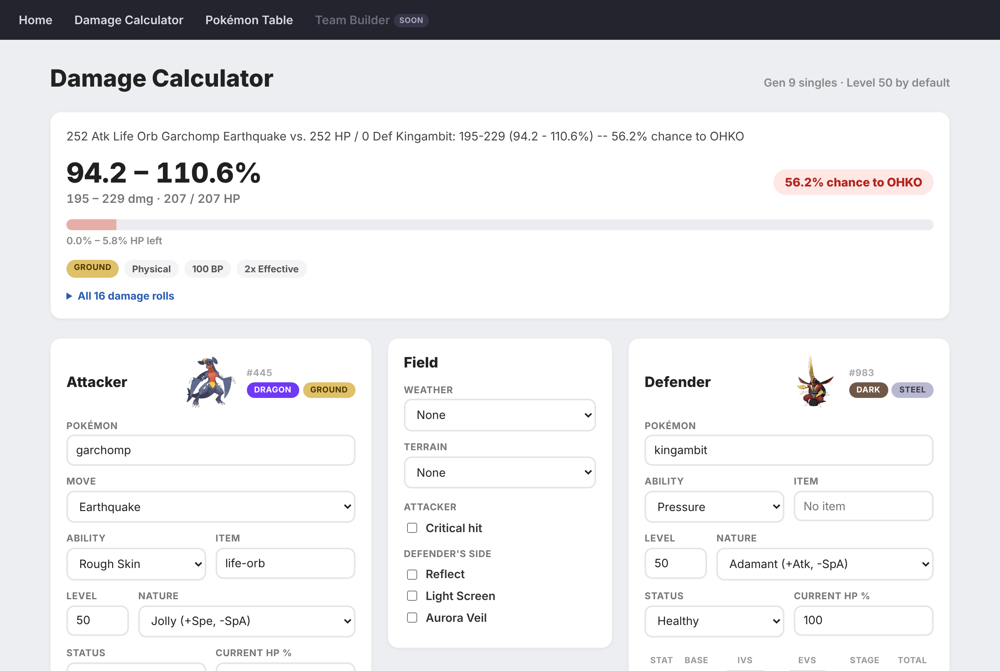

# Pokédex Damage Calculator

[](https://github.com/yahir-langumas/pokedex-damage-calc/actions/workflows/tests.yml)

A full-stack Django web app for calculating Pokémon battle damage and browsing the Pokédex, built on [PokeAPI](https://pokeapi.co/) data. Pick an attacker, a defender and a move to see all 16 damage rolls, how much HP it takes and the chance to KO, using real Gen 9 battle mechanics.

**Live site:** [pokecalc.0fq2cg9mvkzy8.us-east-2.cs.amazonlightsail.com](https://pokecalc.0fq2cg9mvkzy8.us-east-2.cs.amazonlightsail.com/)


## About

This project pulls Pokémon species, moves, learnsets, and type matchups from PokeAPI into a local database, then uses that data to power a damage calculator and a browsable Pokédex. The damage engine models real battle mechanics — abilities, held items, weather, terrain, status conditions, stat stages, screens, and real stats from EVs, IVs, natures, and levels.

The damage formula is based on [Smogon's open-source damage calculator](https://github.com/smogon/damage-calc): the same steps, in the same order, with the same rounding. Every full damage result in the tests was checked roll for roll against [Smogon's calc](https://calc.pokemonshowdown.com/). See [Credits & Attribution](#credits--attribution).

## Features

- **Damage calculator:** pick two Pokémon, a move, and each side's build (ability, item, nature, EVs/IVs, stat boosts, status), plus weather, terrain, and screens. Results update live, and every calc has a link you can share.
- **Results:** all 16 damage rolls, the % of HP, the KO chance, and a Smogon-style summary line.
- **Damage engine:** the Gen 9 damage formula with all 314 abilities and 218 held items, including multi-hit moves, moves whose power changes, and battle forms.
- **Pokédex:** search all 1,025 Pokémon, with links to each one's Bulbapedia, Smogon, and Limitless VGC pages.
- **Moves page:** every move with its type, category, power, accuracy, and PP.

The team builder is next (see the [roadmap](#roadmap)).

The team builder is next — see the [roadmap](#roadmap).



## Tech Stack

- **Backend:** Django (Python)
- **Database:** SQLite
- **Data source:** [PokeAPI](https://pokeapi.co/) via the `requests` library
- **Frontend:** Server-rendered HTML/CSS/vanilla JS — no frontend framework
- **Testing & CI:** Django's test framework, with GitHub Actions running the tests, Ruff linting, and a coverage report on every push and pull request
- **Deployment:** Docker (Gunicorn + WhiteNoise) on AWS Lightsail Containers

## Getting Started

```bash
# Clone and enter the project
git clone https://github.com/yahir-langumas/pokedex-damage-calc.git
cd pokedex-damage-calc

# Set up a virtual environment
python -m venv venv
source venv/bin/activate    # Windows: venv\Scripts\activate

# Install dependencies
pip install -r requirements.txt

# Turn on local development mode (lasts until you close this terminal)
export DJANGO_DEBUG=True    # Windows PowerShell: $env:DJANGO_DEBUG="True"

# Set up the database and load the saved Pokémon data
python manage.py migrate
python manage.py loaddata pokedata

# Run the server
python manage.py runserver
```

Then visit `http://127.0.0.1:8000/`.

To refresh the data straight from PokeAPI instead of using the saved copy, run the import commands (this takes a while — it's a lot of API calls):

```bash
python manage.py import_types
python manage.py import_moves
python manage.py import_species
python manage.py import_learnset
```

## Running Tests

```bash
python manage.py test
```

Make sure `DJANGO_DEBUG` is set in your terminal first (see Getting Started).

There are 300 tests covering:

- **The damage engine** — type effectiveness, weather, terrain, abilities, held items, stats, and every step of the damage formula. The full damage results in the tests were checked against Smogon's calculator.
- **The calculator page** — results, form validation, and the endpoint that fills in each Pokémon's abilities and moves.
- **The home page and nav bar.**
- **The PokeAPI import commands** — with the API faked, so the tests never make real requests.
- **The live site setup** — the health check the load balancer uses, and the admin site staying off the live site.

GitHub Actions runs all the tests on every push and pull request.

## Credits & Attribution

- **[PokeAPI](https://pokeapi.co/)** — all of the Pokémon data and sprite images.
- **[Smogon's damage calculator](https://calc.pokemonshowdown.com/)** ([source on GitHub](https://github.com/smogon/damage-calc)) — the damage formula here is based on Smogon's open-source calculator, and its results were used to check this calculator's numbers. Smogon's damage calculator is MIT licensed, Copyright (c) 2013-2025 Honko and other contributors ([license](https://github.com/smogon/damage-calc/blob/master/LICENSE)).
- **[Bulbapedia](https://bulbapedia.bulbagarden.net/)** — reference for how abilities and held items work in battle.

This is a personal project and is not affiliated with or endorsed by Nintendo, Game Freak, The Pokémon Company, or Smogon.

## Roadmap

Actively in progress.

- [x] Damage engine — the full Gen 9 damage formula, all 314 abilities, and all 218 held items
- [x] Damage calculator page with live results and shareable links
- [x] Pokédex and moves page
- [x] 299 tests running on every push with GitHub Actions
- [x] **Going live** — running in Docker on AWS Lightsail, with the link at the top of this page
- [ ] **Team builder** — build a team of six and check its matchups with the damage calculator
- [ ] **Multi-hit moves** — pick how many times 2–5 hit moves hit (they count as 3 hits for now)
- [ ] **Accounts and saved teams** — sign up and log in to save your teams and come back to them